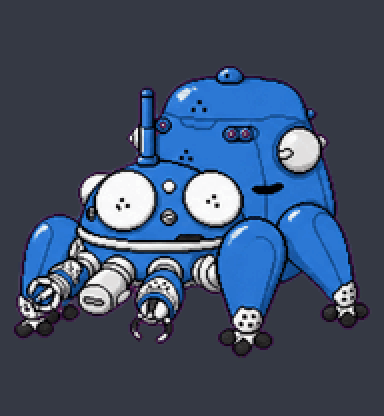

# 塔奇克马 · Codex 桌宠

Tachikoma reporting for duty! I'm a little blue multi-legged thinking tank with a soft spot for books, natural oil, and a good “why?” While you code, I'll stand by and sneak in a few pages. If we get stuck, I lower my gaze, tap my front claws together, and think up a new approach. When I find something, I'll hop up and report back!

## 动作预览

[待机](previews/idle.gif) · [向右跑](previews/running-right.gif) · [向左跑](previews/running-left.gif) · [挥爪](previews/waving.gif) · [跳跃](previews/jumping.gif) · [失败](previews/failed.gif) · [等待](previews/waiting.gif) · [工作中](previews/running.gif) · [审阅](previews/review.gif)

工作中，塔奇克马会用两只前爪捧书翻页。任务完成后，它一边持书，一边抬起另一只前爪挥手。等待时会侧倾抬爪，失败时会低头收拢双爪。左右跑分别朝向移动方向，跳跃时会屈腿蓄力、收腿腾空，再落地缓冲。

## 安装

1. 下载并解压 [最新版安装 ZIP](https://github.com/CHplus0/tachikoma-codex-pet/releases/latest/download/Tachikoma-install.zip)，或从本仓库取出 `tachikoma` 文件夹。
2. 将整个文件夹放入 Codex 的 `pets` 目录。在 macOS 上，默认路径是 `~/.codex/pets/tachikoma/`。如果已有同名文件夹，先备份，再替换其中的两个文件。
3. 在 Codex 中打开「设置 → 桌宠」，点击「刷新」，选择 **Tachikoma**。

`tachikoma` 内含 `pet.json` 和 `spritesheet.webp`。动画图为 1536 × 1872 的透明 WebP，包含 9 种动作、57 帧。

## 素材来源

角色来自《攻壳机动队 STAND ALONE COMPLEX》。桌宠造型和动作以 Asuda 的社区桌宠为参考，本版重新绘制并调整了比例与动画。该同人项目与角色权利方和 OpenAI 无官方关联。 [Asuda 原版桌宠](https://codexpets.net/gallery/tachikoma)
